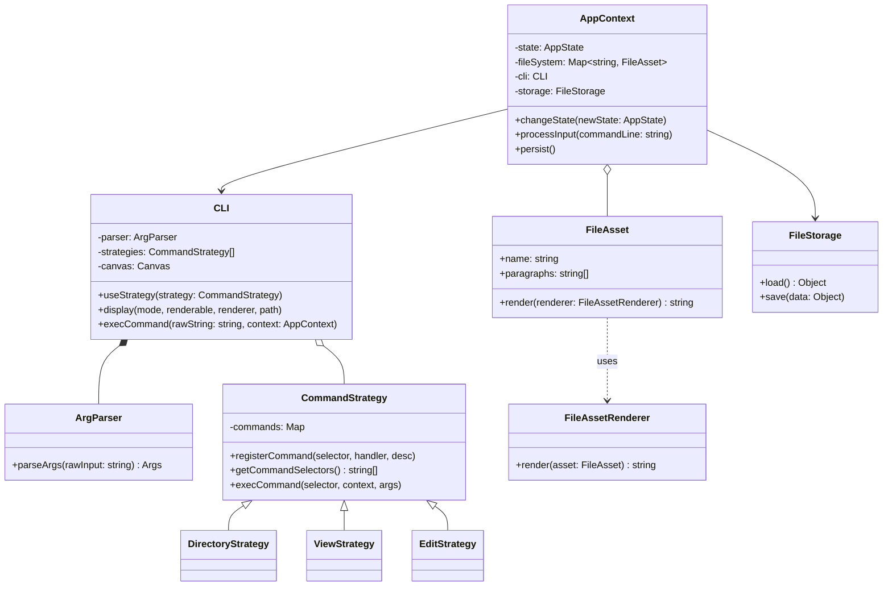

# Software Design Document (SDD)
## Проєкт: Консольний файловий менеджер (`file-manager-cli`)

### 1. Загальний огляд проєкту
**Мета проєкту:** розробка розширюваного консольного застосунку для створення, перегляду, редагування та збереження структурованих текстових документів із чітким розділенням архітектурних шарів.

**Архітектурна модель:** тришарова архітектура (Three-Tier Architecture):
1. **Шар представлення (Presentation Layer / UI — `cli/`, `infra/`):** відповідає за взаємодію з користувачем через термінал, парсинг вхідних рядків та форматування виводу.
2. **Шар бізнес-логіки (Business Logic Layer / CORE — `core/`):** керує життєвим циклом режимів роботи застосунку та доменними сутностями (`FileAsset`).
3. **Шар постійності (Persistence Layer / DATA — `data/`):** забезпечує серіалізацію та збереження даних у локальне сховище (`storage.json`).

---

### 2. Детальний опис реалізації консольного інтерфейсу (CLI)

Консольний інтерфейс побудований із використанням об'єктно-орієнтованих патернів проєктування, що дозволяють додавати нові команди й режими без зміни ядра системи:

#### 2.1. Патерн Facade (`CLI`)
Клас `CLI` виступає єдиною точкою входу для шару представлення. Він інкапсулює роботу парсера аргументів (`ArgParser`), набору активних стратегій команд (`CommandStrategy`) та виведення на полотно (`Canvas`).
* `useStrategy(strategy)` — перемикає активний набір команд відповідно до поточного режиму програми.
* `execCommand(rawString, context)` — парсить рядок користувача та делегує виконання відповідній стратегії.
* `display(modeName, renderable, renderer, currentPath)` — відображає об'єкти, що реалізують контракт `IRenderable`.

#### 2.2. Парсинг вводу (`ArgParser` та `Args`)
* **`ArgParser`** розбиває введений рядок на токени (підтримуючи рядки в лапках `"..."`), виокремлює селектор команди, позиційні аргументи та прапорці формату `--flag` / `--key=value`.
* **`Args`** зберігає результат парсингу у вигляді типізованого об'єкта (`command`, `positional`, `options`).

#### 2.3. Патерн State + Патерн Strategy (Режими та Команди)
Застосунок працює у трьох взаємовиключних станах (`AppState`), кожен із яких при вході (`onEnter`) підключає до фасаду `CLI` власну стратегію (`CommandStrategy`):

| Режим (State) | Стратегія (Strategy) | Доступні команди | Опис дії |
| :--- | :--- | :--- | :--- |
| **`DirectoryState`** | `DirectoryStrategy` | `ls [--detailed]` `create <name> [text]` `delete <name>` `open <name>` | Навігація кореневим каталогом, створення та видалення файлів, перехід до перегляду. |
| **`ViewState`** | `ViewStrategy` | `print [--detailed]` `edit` `close` | Перегляд вмісту та метаданих відкритого документа, перехід у режим редагування. |
| **`EditState`** | `EditStrategy` | `add <text>` `clear` `save` `back` | Додавання нових абзаців, очищення файлу, збереження змін на диск (`storage.json`). |

*Глобальні команди:* `help` (динамічно генерує довідку з поточної активної стратегії) та `exit` (завершення процесу).

#### 2.4. Патерн IRenderable / IRenderer (`FileAsset` та `FileAssetRenderer`)
Щоб не змішувати бізнес-логіку сутності `FileAsset` із деталями консольного форматування, застосовано інверсію залежностей:
* `FileAsset` надає методи `useRenderer(renderer)` та `render(renderer)`.
* `FileAssetRenderer` реалізує форматування документа у звичайному або детальному (`--detailed`) вигляді для термінала.

---

### 3. Схема взаємодії компонентів (UML Class Diagram)

---

### 4. Тестування та запуск
* **Запуск застосунку:** `npm start`
* **Запуск модульних тестів (`node:test`):** `npm test`
* Для тестування без очищення екрана термінала використовується підставний об'єкт `MockCanvas` (Dependency Injection у `AppContext`).
